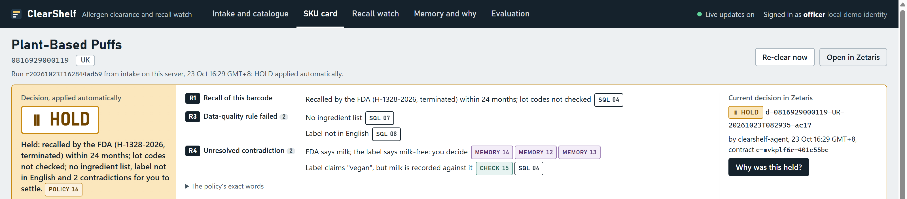

# ClearShelf

[](https://github.com/GitHubMoreLikeGitGud/clearshelf/actions/workflows/ci.yml)

**Allergen clearance and recall watch for online grocers. Every decision is cited and every release is signed.**

Open Agent Hackathon 2026, Track 3: Reasoning Architecture. Team: Umar Mohktar, Singapore - solo.

**[Demo video (3:27)](https://youtu.be/p9bATVx6YsA)** · **[Deck (PDF, 12 slides)](docs/deck/ClearShelf.pdf)** · **[Evaluation report](docs/eval-report.md)** · **[How Cursor was used](docs/how-cursor-was-used.md)**



**The problem.** The user is the product-compliance officer at a UK online grocer that also sells US- and EU-made packaged foods. They sign off the allergen information shown before purchase, which FIC Art. 14 requires for distance selling, and pull or relabel listings when the FSA or FDA publishes an allergy alert. The sources disagree, and the officer reconciles them by hand: Open Food Facts lists Frankie's Plant-Based Puffs (UPC 816929000119) as vegan with no allergens, while Class I FDA recall H-1328-2026 says the product tested positive for undeclared milk. openFDA holds 6,325 food enforcement reports whose recall reason says "undeclared", and 842 of the newest 1,000 concern an allergen.

**What the demo shows** (measured on 23 Oct 2026 on a demo catalogue of 30 products and 33 listings that deliberately includes 14 barcodes taken from FDA recalls; [eval report, section 7](docs/eval-report.md#7-write-back-dq-at-runtime-recall-coverage-and-watch-timing)). In a replayed recall poll, ClearShelf read 15 new notices, held the one exact-barcode match automatically and visibly in Zetaris in a median 68.5 s over 10 runs (57.5 to 93.5 s), and queued 2 name-only matches for the officer. At intake, all 17 listings whose barcode a recall names were held or blocked, 10 more were held or blocked for other reasons with the rule cited, and 6 were proposed for clearance and are waiting for the officer's signature, because nothing clears without one.

**HOLD or BLOCK?** Both are applied automatically. BLOCK means an active recall of this barcode covers this market. HOLD means the listing waits for the officer: a US-only or past recall, a failed data-quality rule, an unresolved contradiction or an incomplete investigation. CLEAR and CLEAR_WITH_STATEMENT run only under an officer-signed, single-use contract.

- **Zetaris** is the only data path. Open Food Facts, openFDA and the UK FSA are Lightning REST tables, joined in the 9-table `clearance_usl` semantic layer with 22 data-quality rules; an invalid record for a product holds it (R3). Every claim cites the Lightning SQL that produced it (95 of 95 cited records re-ran with their rows), and the agent's own decisions are federated back and checked by the `signed_clear` DQ rule.
- **Meterless:** every clearance is a Markovian chain on the vendored engine (unchanged; planner prompts stay at 1,322 to 1,788 tokens per chunk, while a measured full-history prompt reached 4,641 and 6,829 tokens on two investigations: 48% and 58% fewer prompt tokens). H-MEM keeps officer rulings and source facts with provenance, and the World Model answers "what did we know when?". Conformance: 13/13, 8/8, 8/8.
- **NVIDIA Nemotron 3 Nano 4B** runs locally in 2,881 MiB of VRAM with 0 cloud model calls. On 27 real labels it reads "contains" at precision 1.00 against 0.71 for a keyword rule (recall 0.78 against 0.99), with 0 of 15 trap false alarms against 5. The deterministic lexicon verifier alone scores 0.97 / 0.97 on the same labels (it shares its rules with the reference labels), so the model runs as a second reader beside it: any disagreement holds the listing. It reads and plans; it never decides.
- **Cursor:** developed in a Cursor workspace with project rules in `.cursor/rules` and `AGENTS.md`. Every Cursor Agent task (G9, C1 to C3, and C9 after the plan upgrade) and its commit is listed in [`docs/how-cursor-was-used.md`](docs/how-cursor-was-used.md).

**Verify in three minutes, with no Zetaris and no GPU** (Node 22.12+, Python 3.12; all steps in [Quickstart](#quickstart)). Expected output, measured on a fresh clone on 25 Oct 2026:

```bash
cd agent && npm ci && npm test && npm run typecheck && cd ..   # Tests 419 passed (419); tsc exits 0
python -m venv .venv && .venv/Scripts/pip install -r gateway/requirements-dev.txt
.venv/Scripts/python -m pytest gateway/tests -q                # 199 passed, 4 skipped
.venv/Scripts/python -m gateway.onboard --dry-run --offline    # "statements": 125
```


## Contents

[What it does](#what-it-does) · [What is new](#what-is-new) · [Quickstart](#quickstart) · [Architecture](#architecture) · [Zetaris](#zetaris-the-data-layer) · [Meterless](#meterless-reasoning-memory-and-contracts) · [NVIDIA](#nvidia-nemotron-3-nano-4b-locally) · [Cursor](#how-cursor-was-used) · [Evaluation](#evaluation) · [Limitations](#limitations) · [Responsible use](#responsible-use) · [Dependencies](#dependencies-and-licences) · [Data and licences](#data-and-licences)

## What it does

For each product (GTIN) and market (UK or US), ClearShelf runs an investigation and ends in one of four decisions: `CLEAR`, `CLEAR_WITH_STATEMENT`, `HOLD` or `BLOCK`. It does this at intake and again whenever a new recall or alert arrives.

- **One data path, cited.** Open Food Facts, openFDA and the UK FSA are read only through Zetaris. Every claim on the clearance card links to an evidence record holding the Lightning SQL that produced it, the rows, the Zetaris objects, the source URL, the licence and the cache time. The SQL can be pasted into Zetaris and re-run.
- **Reads labels instead of matching keywords.** Nemotron extracts allergen spans from ingredient text in English, German, French, Italian and Spanish, and each span must be an exact substring of the source. A deterministic lexicon checks every span. It knows that cocoa butter is not milk and that "may contain" is precautionary. It also flags coconut: recall texts still call it a tree nut, but FDA's current guidance (Edition 5) and the UK list do not.
- **Tests claims.** A vegan or free-from claim is rated supported, not supported or untested, with the reason.
- **Records contradictions instead of hiding them.** Source against source, model against verifier, memory against source and rule against rule all go on the record and into the officer's queue. None is settled by whichever write came last.
- **Asymmetric autonomy.** HOLD and BLOCK are applied automatically, because that is the safe direction. CLEAR, CLEAR_WITH_STATEMENT and RELEASE run only under an officer-approved, HMAC-signed, single-use execution contract.
- **Closed loop.** Decisions are written to an ops store that Zetaris federates back into the semantic layer. The next recall poll re-checks cleared products inside Zetaris.
- **Memory with provenance.** Officer rulings and source facts carry forward (H-MEM). The World Model answers "what did we know when?". New standing rules come only from dream proposals that a human approves.

## What is new

- **Zetaris DQ results are a policy input.** Data-quality rules on the semantic layer do more than report: an invalid record for a GTIN blocks a CLEAR (rule R3), and the DQ rule is quoted on the card.
- **Citations can be re-run.** The evidence for a claim is the Lightning SQL that produced it. Re-running every cited query returned every cited row (95 of 95; 36 of them cite 0 rows).
- **The agent's own decisions are federated data.** Decisions become a Zetaris table, and a new recall is joined against them inside Zetaris. After every signed write and on every recheck, the `signed_clear` and `known_status` DQ rules check the decisions Zetaris reads back.
- **Conflicts between rules are on the record.** Coconut is a tree nut in a 2026 recall text, but not in FDA's current guidance or on the UK list. ClearShelf queues that conflict instead of picking a side.
- **Autonomy only in the safe direction.** Holds and blocks happen on their own. Clearing needs a signed, single-use contract, which the agent server checks before the write. Zetaris checks again afterwards: the `signed_clear` DQ rule runs after the write and flags any clearance row without a contract. In a test, a signed clearance passed, and an unsigned row written into the ops file directly was flagged ([eval report, section 7](docs/eval-report.md#7-write-back-dq-at-runtime-recall-coverage-and-watch-timing)).
- **A 4B model on a bounded context.** Markovian chunks keep each planner prompt flat, between 1,322 and 1,788 tokens, on a model that runs in 2,881 MiB of VRAM. Measured against the same investigation re-sent with its full history, that is 48% (E1) and 58% (E4) fewer prompt tokens ([eval report, section 6](docs/eval-report.md#6-tokens-per-chunk-chart-data)).

## Quickstart

### A. Three-minute check: no Zetaris, no GPU

Needs Node 22.12 or newer, Python 3.12 and git. On a fresh clone of this repository these steps took about 70 seconds on the development PC (Windows 11), plus download time.

```bash
# Agent: 419 unit tests on synthetic fixtures (no network) and the type check
cd agent && npm ci && npm test && npm run typecheck && cd ..

# Meterless conformance on the vendored engines: 13/13, 8/8, 8/8, then "diff: empty"
cd engines/hmem/reference && npm install && npx tsx ../conformance/runner.ts && cd ../../..
cd engines/markovian/reference && npm install && npx tsx ../conformance/runner.ts && cd ../../..
cd engines/world-model/reference && npm install && npx tsx ../conformance/runner.ts && npx tsx scripts/idempotency-check.ts && cd ../../..
git checkout -- engines   # npm install rewrites the licence field in the vendored lock files

# ClearShelf's H-MEM extension, run through the engine's own conformance runner: 13/13
cd agent && HMEM_IMPL="$PWD/src/memory/hmemFacade.ts" npx tsx ../engines/hmem/conformance/runner.ts && cd ..

# Gateway: 199 passed, 4 skipped on a fresh clone (the skipped ones need live Zetaris or local data)
python -m venv .venv
.venv/Scripts/pip install -r gateway/requirements-dev.txt        # macOS/Linux: .venv/bin/pip
.venv/Scripts/python -m pytest gateway/tests -q

# Print all 125 Zetaris statements that onboarding would send, without connecting
.venv/Scripts/python -m gateway.onboard --dry-run --offline
```

### B. Full stack: Zetaris, gateway, agent and UI

**Prerequisites**

- Docker Desktop with the Zetaris platform installed locally. This is Zetaris 2.4.3.1 with the `ui`, `api`, `driver` and `postgres` containers: the UI is on `localhost:3000`, JDBC on `localhost:10000`, and the Docker network is `zetaris_default`. The platform bundle, which includes the JDBC driver JAR, and the registry login come from the "Run locally" page of a Zetaris Cloud account.
- Java 11 or newer (tested with 21), Python 3.12, Node 22.12 or newer.
- [Ollama](https://ollama.com) (tested with 0.40.7) and the model: `ollama pull nemotron-3-nano:4b` (2.8 GB). It used 2,881 MiB of VRAM on an RTX 4070 Ti SUPER 16 GB.
- Tested on Windows 11. The commands below are PowerShell; on macOS or Linux use `.venv/bin/` instead of `.venv\Scripts\`.

**Steps**

```powershell
Copy-Item .env.local.example .env.local
#   ZETARIS_JDBC_JAR             path to the driver JAR from the Zetaris bundle
#   ZETARIS_ADMIN_USERNAME/_PASSWORD   your Zetaris login
#   CLEARSHELF_USER_AGENT        "ClearShelf/0.1 (<your contact>)", sent to Open Food Facts as it asks
#   CLEARSHELF_CONTRACT_SECRET   python -c "import secrets; print(secrets.token_hex(32))"

python -m venv .venv
.venv\Scripts\pip install -r gateway\requirements.txt
docker compose -f ops/docker-compose.ops.yml up -d            # ops store (nginx) on the zetaris_default network

.venv\Scripts\python -m gateway.onboard --dry-run --skip-exists
.venv\Scripts\python -m gateway.onboard --skip-exists          # REST tables, USL, links, activations, DQ rules
.venv\Scripts\python -m gateway.app                           # terminal 1: gateway on 127.0.0.1:8791

cd agent
npm ci
npm run warmup                                                # gateway cache, model load, memory seed
npm run dev                                                   # terminal 2: open http://127.0.0.1:8790
```

- Onboarding registers one Open Food Facts table per catalogue SKU: 30 catalogue products by default, and 40 registered with the 10 eval-only SKUs (`--roles demo,eval_only`). Calls to Open Food Facts are spaced 5 s apart by default (never below 2.5 s), so a full run takes several minutes; 40 tables took about 9 minutes. `--skip-exists` makes reruns idempotent. Per-script details and the verified row counts are in [`zetaris/README.md`](zetaris/README.md).
- Optional: set `ZETARIS_GETTING_STARTED_DIR` to a clone of [zetaris/getting-started](https://github.com/zetaris/getting-started) before `npm run warmup`. H-MEM is then seeded with that repository's source manifest and the source-access findings mined from its `known_to_fail` notes.
- Without `ZETARIS_READER_*` credentials, the gateway runs read templates on the admin login behind the reader allowlist (see [Limitations](#limitations)).

### Try it

1. **Intake:** enter `816929000119` (the UPC-A on the FDA recall; it is normalised to the GTIN-13 `0816929000119`), market UK. EAN-13, UPC-A, EAN-8 and GTIN-14 with indicator 0 are accepted. The Puffs are held under R1 (recall H-1328-2026), R3 (the DQ gate: no ingredient list) and R4 (contradictions), and the vegan claim is rated not supported. The hold is applied automatically.
2. Click any evidence chip to open the **evidence drawer**: the Lightning SQL, its sha256, rows, objects, source URL, licence and cache time.
3. **Why was this held?** shows a plain trace, the H-MEM ledger and the World Model timeline.
4. **Recall watch:** replay as of 10 Oct 2026, then poll. The Donutful cake (`0850041392103`) is held in the UK under R1, because the FDA recall covers US distribution only. Every row of the replay carries a replay label. The closed-loop recheck on this screen also shows Zetaris's `signed_clear` and `known_status` DQ results on the written-back decisions. For a live watch that polls on its own, set `CLEARSHELF_WATCH_EVERY_MIN` (5 or more) in `.env.local` before `npm run dev` and press **Go live**; results appear on this screen and in the catalogue (there are no push notifications).
5. **Intake** `5000169566558` (a UK dark chocolate), market UK. It is proposed as CLEAR_WITH_STATEMENT ("May contain: Peanuts, Milk, Nuts."). Approve it with a reason: a signed contract is issued, the decision is written back, and it is visible in Zetaris (`clearance_usl.decision`).
6. **Memory:** allergen conflicts to resolve, dream proposals (they need two officer rulings that agree) and the World Model merge queue.

**Command line** (from `agent/`):

```bash
npm run clear -- --gtin 0816929000119 --market UK   # one clearance (--no-apply for a dry run)
npm run replay -- --as-of 2026-10-10               # recall watch replay from that date, then a poll
npm run watch                                      # one poll of openFDA and FSA through Zetaris (the server polls on a timer with CLEARSHELF_WATCH_EVERY_MIN)
npm run cli -- why --gtin 0816929000119 --market UK
npm run eval                                       # the 10 scenarios (run the replay first, for E2)
npm run eval:extraction                            # measurement scripts behind docs/eval-report.md
npm run eval:cold-warm
npm run demo:snapshot -- --name <name>             # save, and later restore, the demo state
npm run demo:reset -- --name <name>
```

The API contract the UI is built on is in [`docs/api.md`](docs/api.md).

## Architecture

The diagram above is drawn by [`docs/architecture.py`](docs/architecture.py) ([SVG](docs/architecture.svg)). A clearance runs like this:

1. **Zetaris** federates three public sources as Lightning REST tables and caches them, and models them in the `clearance_usl` Unified Semantic Layer with PK/FK and custom DQ rules.
2. **The gateway** (`gateway/`, Python, FastAPI + JDBC, `127.0.0.1:8791`) is the only route to Zetaris. The agent sends a template id and parameters, never SQL. The gateway checks them against an allowlist, runs the named template, and logs each statement with its sha256. That logged text becomes the citation.
3. **The Markovian loop** (`agent/src/loop/`) runs the vendored Markovian orchestrator unchanged. ClearShelf's generator asks Nemotron which tool to call next, and a NEEDS_TOOL executor runs that tool: Zetaris templates, extraction, the verifiers, memory reads. The carried state is capped at 768 tokens, and a checklist defines when the investigation is complete.
4. **Deterministic verifiers and policy** (`agent/src/verify/`, `agent/src/policy/decide.ts`) decide. Rules R0 to R6 cover preconditions, exact-GTIN recalls, name-only matches, the DQ gate, contradictions, clear with a statement, and clear. Every firing cites evidence ids, and an approved memory invariant can only make a decision stricter.
5. **Signed actions** (`agent/src/contract/`): HOLD and BLOCK are written immediately. CLEAR, CLEAR_WITH_STATEMENT and RELEASE need an execution contract that the officer approves with a reason. The contract is HMAC-signed, single-use and expires within 15 minutes, and a contract signed before a later HOLD or BLOCK is refused.
6. **Write-back and read-back:** decisions go to `data/ops/*.json` with atomic writes. An nginx container (`ops/`) serves them to Zetaris as `http://clearshelf-ops`. Zetaris reads them back as `CLEARSHELF_OPS` tables and the USL `decision` table, which the recheck and the `signed_clear` DQ rule query.
7. **H-MEM and the World Model** (`agent/src/memory/`, `agent/src/world/`) keep facts, rulings, conflicts and the catalogue history across runs. **The officer UI** (`ui/`, plain HTML and ES modules over SSE, `127.0.0.1:8790`) shows all of it.

| Path | What it holds |
|---|---|
| `agent/` | Node 22 + TypeScript (tsx, no runtime dependencies): loop, verifiers, policy, memory, World Model, contracts, server, CLI; tests in `agent/test/` |
| `gateway/` | Python 3.12 Zetaris gateway: templates, allowlist, registrar, contract check, onboarding; tests in `gateway/tests/` |
| `zetaris/` | Lightning SQL `NN_*_create.sql` / `_select.sql` pairs, the OFF template, DQ rule docs, verified counts |
| `ui/` | officer UI, no build step |
| `engines/` | Meterless H-MEM, Markovian and World Model reference engines, vendored unchanged |
| `ops/` | the nginx compose file that serves the ops store to Zetaris |
| `data/reference/`, `data/manifest/` | the cited UK/US allergen table and the intake manifest (everything else in `data/` is runtime state and gitignored) |
| `docs/` | evaluation report, conformance results, Nemotron bench, API contract, Cursor task files |

## Zetaris: the data layer

Zetaris is ClearShelf's only runtime path to data. It federates the sources, caches them, holds the semantic contract (the USL), gates clearances with DQ rules, and federates the agent's own decisions back. Instance: local Docker, Zetaris 2.4.3.1, reached over JDBC (`jdbc:zetaris:lightning@localhost:10000`).

**Lightning databases and REST tables** (`zetaris/sql/00` to `04`):

| Object | Source | Notes |
|---|---|---|
| `CLEARSHELF_OFF.off_<gtin13>` | Open Food Facts product API v2, one table per SKU | cached; `DESCRIBE` first, because missing fields fail with `FIELD_NOT_FOUND` |
| `CLEARSHELF_FDA.enforcement_undeclared` | openFDA food enforcement, `reason_for_recall:undeclared` | cached; the newest 1,000 of 6,325 matching reports (23 Oct 2026) |
| `CLEARSHELF_FSA.allergy_alerts` | UK FSA food alerts, type AA | cached; 200 alerts, 349 alert × allergen rows |
| `CLEARSHELF_OPS.decisions`, `.recall_links`, `.extractions`, `.market_allergens`, `.health` | ClearShelf ops store via nginx | never cached, so a write-back is visible on the next query |

**Unified Semantic Layer** `lightning.metastore.clearshelf.clearance_usl` (`zetaris/sql/10`, compiled as one statement, then activated by `11`). Nine tables, with row counts from the full onboarding run:

| `market_allergen` | `fda_recall` | `fsa_alert` | `fsa_alert_allergen` | `product` | `declared_allergen` | `recall_product_link` | `extracted_allergen` | `decision` |
|---|---|---|---|---|---|---|---|---|
| 23 | 1,000 | 200 | 349 | 30 | 111 | 14 | written by the agent | written by the agent |

**The DQ gate.** There are 22 rules: 9 primary-key, 8 foreign-key and 5 custom (`has_ingredients`, `english_label`, `known_relation`, `signed_clear`, `known_status`). All of them are listed in [`zetaris/dq-rules.md`](zetaris/dq-rules.md). The policy cannot propose a CLEAR while `has_ingredients`, `english_label` or a `market_code` foreign key returns an invalid record for the GTIN. The SKU is held under R3 instead, quoting the rule. Crowd-sourced tags turn up as foreign-key orphans: in the full run, 6 of the 111 declared-allergen rows have a market code with no statutory entry, such as `UK:blé` or `US:gluten_cereal`. `RUN DQ` is bounded at 60 s in the gateway. If DQ does not answer in time, the gateway runs the equivalent plain SQL and labels the evidence "DQ-equivalent SQL".

**Closed loop.** A decision is written to `data/ops/decisions.json` and read back through `CLEARSHELF_OPS.decisions` into the USL `decision` table. The recall watch's recheck (`/api/recheck`) joins decisions, recall links and recalls inside Zetaris, then runs `SHOW DQ INVALID RECORD` for `signed_clear` (any CLEAR or CLEAR_WITH_STATEMENT row without a contract id) and `known_status` on the decision table. `signed_clear` also runs after every signed write, and the officer sees whether the new row passed. The join map (`/api/join-map`) shows how recall UPCs matched catalogue GTINs: `ean13` 3 of 3 links, `upc12_pad13` 11 of 11.

**Measured on this instance.** These numbers come from [`zetaris/README.md`](zetaris/README.md).

- Counting the 1,000 openFDA reports takes about 0.1 s cached against 0.9 to 2.8 s uncached.
- The cache is driver-wide, not per session.
- A one-GTIN read of `product` takes about 2.3 s with 40 SKUs in the union.
- `RUN DQ` takes about 5.5 s on `product` and 11 to 13 s on `declared_allergen`.

**What we learned.** The driver treats a `?` inside a REST URL as a bind parameter when the statement is prepared, so the gateway sends plain statements. NOT NULL keys built with `concat()` need `COALESCE`. Quoted USL descriptions keep their quotes. Each of these is recorded in `zetaris/README.md`.

## Meterless: reasoning, memory and contracts

The engines come from [Meterless/Meterless](https://github.com/Meterless/Meterless) at commit `1742dec56a66e58eef9dda2d2b865823758ca8cd`. They are vendored unchanged (see [`engines/UPSTREAM.md`](engines/UPSTREAM.md)), and ClearShelf extends them only from `agent/src/` by subclassing, wrapping or composing. `git diff -- engines/` is empty. Full results are in [`docs/conformance.md`](docs/conformance.md). The suites were run again on 23 Oct 2026 on this commit.

| Engine | How ClearShelf uses it | Where | Conformance |
|---|---|---|---|
| **Markovian**, vendored | Every SKU clearance and recall sweep is a Markovian chain. Nemotron plans each chunk, a NEEDS_TOOL executor runs the tool, and the carried state is capped at 768 tokens. Measured: the planner prompt stays between 1,322 and 1,788 tokens per chunk. The same investigations re-sent with their full history measured 4,641 tokens at chunk 4 (E1) and 6,829 at chunk 5 (E4); summed over the chunks, the Markovian prompts were 48% and 58% smaller. The chars/4 estimate had said 3,301 and 4,581. | `agent/src/loop/` | 8/8 |
| **H-MEM**, vendored and extended by subclass | Facts with Zetaris provenance (`source: zetaris:<object>`, SQL hash), officer rulings, the trust ledger and "why" traces. Allergen conflicts are always queued, never auto-resolved. Dreaming is human-approved, and an approved invariant can only make a decision stricter. | `agent/src/memory/` | 13/13 vendored; 13/13 with ClearShelf's subclass loaded through the engine's own runner |
| **World Model**, vendored and wrapped | A graph of products, brands, firms, notices and allergens, with edges dated by source time. Each decision gets a snapshot, so the timeline shows what was known when. A name match of 0.85 or more becomes a review link that never changes a listing; one between 0.82 and 0.85 goes to a merge queue for approval. | `agent/src/world/` | 8/8; idempotency check `diff: empty`; re-ingesting live Zetaris rows (30 products, 9 FSA alerts) appended 0 events after 378 the first time |
| **Scout Intent**, partial reimplementation (no reference engine is vendored) | An injection guard on every untrusted text before the model sees it, and risk classes. Signed single-use execution contracts (HMAC) are high-risk for CLEAR, CLEAR_WITH_STATEMENT and RELEASE, which the agent server verifies, and medium-risk for Zetaris registrar calls, which the Python gateway verifies (`gateway/contracts.py`). This is an integrity check, as in Scout's own documentation, not cryptographic-grade security. | `agent/src/contract/` | The guard passes the 10 Scout injection regression cases (7 injections, 3 clean) vendored from the Meterless repository, plus synthetic food-domain cases |

## NVIDIA: Nemotron 3 Nano 4B, locally

`nemotron-3-nano:4b` (Q4_K_M) runs in local Ollama 0.40.7 on an RTX 4070 Ti SUPER 16 GB. Settings: temperature 0, seed 7, `num_ctx` 8192, one call at a time. Output follows a JSON schema (Ollama `format`) and is validated on the host. An invalid reply is retried once; after that, a deterministic fallback step is taken and labelled as one.

Nemotron does four jobs and decides nothing:

1. **Multilingual ingredient extraction** into grounded spans (think off).
2. **Recall-notice extraction** (think off).
3. **The Markovian planner**, which chooses the next tool (think on).
4. **The H-MEM miner**, which turns source documents and officer reasons into memories (think off) and words dream proposals in one sentence.

| Measured (`docs/eval-report.md`, `docs/nemotron-bench.md`) | Value |
|---|---|
| Extraction speed, median | 159.8 tokens/s; 2.0 s per call (3.8 s including the Zetaris read). 25 Oct re-run: 154.1 tokens/s; 2.1 s (3.9 s) |
| Planner speed, median per run | 150.0 to 155.6 tokens/s (25 Oct re-run: 146.4 to 150.5) |
| Full investigation of one SKU | 48 to 94 s |
| JSON valid on the first attempt | extraction 27/27; planner 57/65 (88%), 65/65 after one repair, 0 fallback steps in the 8 real investigations. 25 Oct re-run on `aeb5b92`: 59/65 (91%), 64/65 after one repair, 1 fallback step (E3) |
| VRAM | 2,881 MiB, all of the model in VRAM |
| Cloud model calls | 0. The model client accepts loopback URLs only. |
| Cold vs warm (same SKU) | reusing H-MEM's verified extraction cut tool-model tokens by 67% in and 94% out; 61.1 s vs 48.1 s |
| Extraction on 27 labels, `contains` precision / recall | Nemotron Q4_K_M 1.00 / 0.78; Q8_0 1.00 / 0.84; **the lexicon verifier alone, no model, 0.97 / 0.97**; keyword rule 0.71 / 0.99 |
| Recall by label language (Q4 / Q8 / lexicon alone) | English, 21 labels: 0.90 / 0.90 / 0.98; German, 4: 0.50 / 0.70 / 0.95; French, 1: 0.60 / 0.80 / 1.00; Italian, 1: 0.83 / 0.83 / 1.00 |
| Q8_0 against Q4_K_M | 113.1 against 154.1 tokens/s (27% slower), 2.55 against 2.09 s per extraction call, 4,066 against 2,881 MiB of VRAM; Q4 stays the default |

**What the 25 Oct re-run shows against the model.** On these 27 labels the deterministic lexicon verifier alone reads `contains` and "may contain" better than Nemotron (26/27 exact "may contain" reads against 18/27). The comparison favours the lexicon, because the reference labels' text rule uses the same lexicon. The two readers miss different things (the lexicon found 17 of the model's 18 misses; the model found 1 of the lexicon's 2), and ClearShelf holds every disagreement for the officer. Q8_0 recovers part of the non-English gap at a speed and memory cost. Details in [`docs/nemotron-bench.md`](docs/nemotron-bench.md).

The Day-0 bench chose these settings. With think on, extraction gave valid JSON on only 2 of 10 calls, because the thinking ran into the 4,096-token cap, so think is off for extraction. The optional 30B tier was cut: its weights needed about 11.8 GB of host RAM (estimated) against 7,971 MiB available.

## How Cursor was used

ClearShelf was developed in a Cursor workspace with project rules in `.cursor/rules` and `AGENTS.md`. Cursor Agent ran the Zetaris JDBC preflight against our local instance. It drafted the decision write-back SQL, the per-product Open Food Facts registration template and the DQ rule documentation, with static tests for the SQL. It also drafted the multilingual allergen lexicon, the jurisdiction rules, the GTIN normaliser and the claim tester, with their tests. Its Free plan then reached its usage limit, so the remaining planned Cursor tasks were not run by Cursor Agent. After the submission and an upgrade to the Pro plan, Cursor Agent made the runtime tests independent of the date (C9). Every Cursor task, its commit and what was corrected afterwards are listed in [`docs/how-cursor-was-used.md`](docs/how-cursor-was-used.md).

## Evaluation

All numbers are measured unless labelled otherwise. The full report is [`docs/eval-report.md`](docs/eval-report.md), from runs on 23 Oct 2026 with the model, the gateway and Zetaris on one machine. The replay, the scenarios and the evidence-quality scoring were run again on 25 Oct 2026 on the clean commit `aeb5b92`, with the same decisions, rules and evidence counts; a score-only summary is in [`docs/eval/`](docs/eval/).

**Scenarios: 10 of 10 pass** (`npm run eval`: 408 s on 23 Oct, 467 s in the 25 Oct re-run):

| ID | Case | Result |
|---|---|---|
| E1 | Plant-Based Puffs UK: vegan in Open Food Facts, milk recall in openFDA | HOLD (R1, R3, R4); vegan claim not supported; memory conflict queued |
| E2 | Donutful UK, replay from 10 Oct, then poll | HOLD (R3), then HOLD (R1) applied automatically; labelled as a replay |
| E3 | Lidl apricot and coconut biscuits, UK | HOLD; the coconut rule-against-rule conflict surfaced |
| E4 | the same biscuits, US | BLOCK (R1); the statement says Wheat, not Coconut |
| E5 | Dark Chocolate UK | CLEAR_WITH_STATEMENT, pending signature; "May contain: Peanuts, Milk, Nuts." |
| E6 | Kellogg's granola, UK, no ingredient text | HOLD (R3); vegan claim untested |
| E7 | Lambertz Composition (German label), UK | HOLD (R3 english_label, R4) |
| E8 | synthetic prompt-injection fixture (eval only) | HOLD (R4); the injected text reached the model only wrapped as untrusted |
| E9 | FSA alert matched by name only | no automatic action |
| E10 | RELEASE without a contract | 403; ops store unchanged (sha256) |

**Evidence quality:**

- Every card claim, policy firing and review item cites evidence (7/7 cards, 43/43 firings, 37/37 review items).
- 200/200 evidence records are complete.
- Re-running the cited SQL returns every cited row (95/95).
- Every span shown is an exact substring of its source (19 kept, 1 dropped and counted).
- 3/3 expected contradictions were found.
- 0 CLEAR proposals on a GTIN with an ongoing recall; 0 CLEAR, CLEAR_WITH_STATEMENT or RELEASE executed without a signed contract.
- Zetaris's `signed_clear` DQ rule, run after a signed test clearance, passed the new row (0 invalid records). A synthetic unsigned CLEAR row written into the ops file directly was flagged (1 invalid record) and then removed.

**Extraction** (27 SKUs, 402 allergen-group pairs; scored against reference labels derived by documented rules, never typed by hand):

| `contains`, micro | Precision | Recall | Trap false alarms | Precautionary exactly right |
|---|---|---|---|---|
| Keyword baseline | 0.71 | 0.99 | 5/15 | 0/27 |
| Nemotron | **1.00** | 0.78 | 0/15 | 18/27 |
| Nemotron + verifier | **1.00** | 0.78 | 0/15 | 18/27 |
| Nemotron Q8_0 (25 Oct) | **1.00** | 0.84 | 0/15 | 16/27 |
| Lexicon verifier alone, no model (25 Oct) | 0.97 | 0.97 | 1/15 | 26/27 |

**What did not go well:**

- **The model misses allergens.** Recall is 0.78 overall and 0.58 on the six German, French and Italian labels. ClearShelf does not clear on a miss: when the verifier finds a word the model missed, the SKU is held under R4 for the officer. All 18 missed `contains` pairs fall in 11 SKUs, each of which had a model/verifier disagreement, so none of those SKUs could be proposed for clearance. That count is per SKU, and it is partly circular: the reference labels use the same lexicon as the verifier, so it does not show that misses outside the lexicon are caught. 21 of the 27 SKUs (78%) had at least one model/verifier disagreement, so the officer sees many holds.
- **The lexicon alone outscored the model.** Without any model, the deterministic verifier scores 0.97 / 0.97 and reads "may contain" exactly right 26 of 27 times. Part of that is circular (the reference labels use its lexicon), but the model's extraction recall is plainly the weaker side; it earns its place as a second reader whose disagreements are held, and in the jobs the lexicon cannot do.
- **Precautionary wording** was read exactly right in 18 of 27 cases.
- **The planner** returned valid JSON on the first try 88% of the time on 23 Oct, and one repair fixed the rest. In the 25 Oct re-run it was 91%, but one reply stayed invalid after the repair, so E3 took one deterministic fallback step.
- **The verifier can be wrong too.** In E3, the French word for coconut is split by an address pasted into the Open Food Facts text, so the draft lists "Nuts (walnut) (to confirm)". A statement that still says "(to confirm)" cannot be signed.
- **E4 is only partly met.** It cites the DQ `market_code` rule (2 invalid records) but does not name the orphan key.
- **E2's expectation changed before the run.** It was BLOCK in the build plan and became HOLD by a recorded decision: a US-only recall does not cover UK units. The reason is in the report.
- **Not measured:** the 10 eval-only SKUs (no row in the USL `product` table), a think on/off ablation of the planner, the model's own peak VRAM apart from the whole GPU, cold vs warm on an empty memory store, and officer time saved (there is no baseline of the manual check). The report generator task (C6) was not built; the report is written from the measurement output.

## Limitations

- **Decision support, not legal advice.** The reference table cites UK/EU and US law and guidance, but the officer is responsible for every published statement.
- **No least-privilege reader yet.** The non-admin Zetaris role was not set up, so the gateway runs read templates on the admin login. A reader allowlist restricts them to read statements, and `/health` reports `admin_fallback`.
- **A local demo identity.** `POST /api/approvals/sign` issues an officer-approved contract to any request on this machine that names the server as its Host and carries no foreign `Origin` (the DNS-rebinding and cross-site checks). There is no login, so a local process without an `Origin` header can sign. A real deployment needs single sign-on in front of the officer endpoints.
- **Execution contracts are an integrity check.** They are HMAC-signed and single-use, as in Scout's own documentation, not cryptographic-grade security.
- **No push notifications.** The recall watch polls on request, or on a timer when `CLEARSHELF_WATCH_EVERY_MIN` is set and the watch is live. Its holds appear in the UI; nothing is sent to the officer.
- **Exact GTIN matching only.** Lot codes are not matched, so a terminated recall within 24 months holds a SKU ("lot codes not matched"). FSA alerts carry no GTIN, so an FSA match is by name only: the recall watch queues it for the officer and changes no listing.
- **Open Food Facts stands in for the grocer's supplier feed.** It is crowd-sourced and can lag the printed label. Recall positives describe the product, not its label.
- **Scope:** UK and US markets, 30 catalogue SKUs (33 SKU-markets) plus 10 evaluation-only SKUs. There is one officer and no concurrency beyond one model job at a time. Tested on Windows 11 only.
- **Zetaris instance state:** the instance keeps the first `signed_clear` expression, which also lists RELEASE, because the onboarding allowlist does not admit `UPDATE DQ`. The two expressions differ only on a RELEASE row, which `known_status` rejects either way.

## Responsible use

- The model never decides. A deterministic policy decides, the statement builder writes statements, and every count comes from SQL.
- ClearShelf never publishes a free-from or allergen statement on its own. Clearing and releasing take the officer's reason and signature, and an edited statement that drops a verified allergen is flagged.
- Replayed events carry a replay label everywhere, and synthetic fixtures (E8) are labelled as synthetic and kept out of the catalogue.
- Untrusted text (product names, ingredients, recall descriptions, alert titles) is scanned and wrapped before any model sees it. A hit holds the SKU.
- No personal data is collected. Firm street addresses in openFDA descriptions are replaced with `[address removed]` in SQL. No Open Food Facts contributor fields are read.
- Source etiquette: 5 s between Open Food Facts calls by default (never below 2.5 s), with an identifying User-Agent; openFDA well under its daily limit; modest FSA polling. All sources are cached in Zetaris.
- Secrets live only in `.env.local`, which is gitignored. They never appear in prompts, logs or evidence.

## Dependencies and licences

| Component | Version | Licence |
|---|---|---|
| Node.js | 22.12 or newer | MIT |
| tsx, vitest, vite, @types/node (dev only; the agent has no runtime dependencies) | 4.23.15, 5.0.3, 7.3.7, 22.20.5 | MIT |
| TypeScript (dev only) | 7.0.2 | Apache-2.0 |
| FastAPI, pytest (dev) | 0.161.1, 9.1.1 | MIT |
| uvicorn, httpx (dev) | 0.54.0, 0.28.1 | BSD-3-Clause |
| JayDeBeApi | 1.2.3 | LGPL-3.0 |
| JPype1 | 1.7.1 | Apache-2.0 |
| Meterless reference engines (vendored) | commit `1742dec` | Apache-2.0 |
| nginx image | 1.27-alpine | BSD-2-Clause |
| Ollama | 0.40.7 | MIT |
| NVIDIA Nemotron 3 Nano 4B (`nemotron-3-nano:4b`, not redistributed) | Q4_K_M | NVIDIA Open Model License |
| Zetaris platform 2.4.3.1 and its JDBC driver (not redistributed) | 2.4.3.1 | Zetaris terms |
| Java runtime | 11 or newer (tested 21) | per distribution |

## Data and licences

- **Open Food Facts:** "Data from Open Food Facts (openfoodfacts.org), ODbL." The database is licensed under the [Open Database License 1.0](https://opendatacommons.org/licenses/odbl/1-0/) and individual contents under the Database Contents License. At runtime the data is read through Zetaris and not redistributed. The committed intake manifest (`data/manifest/skus.json`) keeps, for 40 products, the barcode, product name and brand, language, allergen, trace and label tags, and a hash of the ingredient text. It holds no ingredient text.
- **openFDA food enforcement reports** (U.S. Food and Drug Administration): public domain / CC0 1.0. ClearShelf is not endorsed by the FDA. The manifest quotes recall numbers, dates, classifications, statuses, firm names and recall reasons.
- **UK Food Standards Agency food alerts:** "Contains public sector information licensed under the Open Government Licence v3.0."
- **Regulatory reference** (`data/reference/market_allergens.json`): transcribed from the FSA allergen guidance and legislation.gov.uk (Open Government Licence v3.0) and from FDA guidance (U.S. government work), with a citation on every row.
- No bulk source data is in the repository. No personal data is collected. Firm address fields are never selected, and street addresses inside openFDA product descriptions are removed in SQL.

## Pre-existing code

ClearShelf was written for this hackathon. The only pre-existing code is:

- **The Meterless reference engines** H-MEM, Markovian and World Model (Apache-2.0), vendored unchanged in `engines/`, plus the 10 Scout injection regression cases in `agent/test/fixtures/scout-injection/`.
- **`gateway/jdbc.py`**, adapted from `scripts/zetaris_sql.py` in the [Zetaris getting-started repository](https://github.com/zetaris/getting-started) at commit `6a2fbaa` (Apache-2.0). The adapted parts are the `.env.local` loader, the SQL statement splitter and the JayDeBeApi channel. ClearShelf added Windows JDK discovery, column names and timings in results, a bounded wait with statement cancel, and a lock per connection.

## Licence

Apache-2.0, see [`LICENSE`](LICENSE) and [`NOTICE`](NOTICE).
